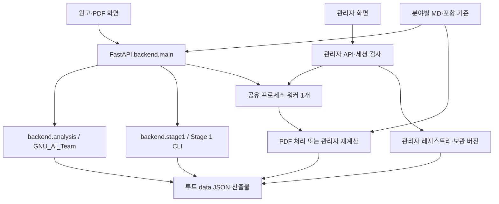

# 구조·저장 데이터·API

## 1. 실행 구조



브라우저는 서버와 같은 출처의 API를 호출합니다. 프런트엔드는 정적 파일이며 서버에서 파일을 제공합니다. 현재 외부 DB·메시지 큐·LLM 서비스는 사용하지 않습니다.

PDF 작업과 관리자 재계산은 `ProcessPoolExecutor(max_workers=1)`을 공유합니다. Uvicorn 앱 프로세스도 하나로 유지합니다. 원고 분석 API는 동기 핸들러에서 처리하며 내부 Stage 1 CLI를 실행합니다. 모든 분석이 백그라운드 작업 API를 통해 실행되는 것은 아닙니다.

## 2. 모듈별 책임

| 파일 | 주요 책임 |
|---|---|
| `backend/main.py` | 앱 수명주기, 공용 API, 업로드 검증, PDF 작업, 결과·판정·다운로드, 포함 기준 등록 |
| `backend/analysis.py` | GNU 동사·헷지·선행연구 스크립트 동적 로딩, 텍스트 분할, 문헌 요약·분야 평균 |
| `backend/stage1.py` | 표준 문장 입력, 원본 CLI 호출, CSV→JSON, 모델 호환성·규칙 해시 확인 |
| `backend/admin.py` | 관리자 인증, 현재 기준 포인터, 불변 버전, 상태 조정, 적용·복원·변경 이력 |
| `backend/admin_worker.py` | 고정 MD·규칙 사본 검증, 어댑터·CLI 실행, 통계 재검산, 결과 JSON 생성 |
| `scripts/build_markdown_baselines.py` | MD 헤딩·블록 전처리, 표준 TXT·TSV, 구조 점검 |
| `scripts/finalize_markdown_baselines.py` | 포함 기준 JSON·감사 보고·요약·해시 생성 |
| `scripts/render-build.sh` | Python·분석기·모델 설치 및 버전 검사 |
| `frontend/app.js` | 원고·PDF 상태, 입력·결과 탐색, 표·근거·판정·다운로드 |
| `frontend/admin.js` | 분야·탭, 작업 조회, 버전 미리보기, 적용·복원 |

## 3. 시작·종료 동작

서버 시작 시 다음 순서로 처리합니다.

1. 루트 `data/jobs`, `data/baselines` 생성.
2. 포함 IC 예시 CSV에서 JSON을 가져오고 동일 내용인지 확인.
3. `baselines_markdown/*/baseline.json`을 런타임 폴더에 등록. 해당 ID 파일이 이미 있으면 자동 덮어쓰지 않음.
4. 관리자 자격 정보가 없으면 생성. 레지스트리가 없으면 분야별 최신 MD 기준을 초기 등록.
5. 남아 있던 queued/running 관리자 작업은 failed 처리하고 완료/실패 이력 조정.
6. 남아 있던 queued/running PDF 작업도 failed 처리.
7. 백그라운드 프로세스 풀 생성.

종료 시 풀에 `shutdown(wait=True)`를 호출합니다. 프로세스가 강제 종료되어 중단된 작업은 자동 재개하지 않습니다. 파일이 유지되는 환경에서만 이 상태 복구가 가능합니다.

## 4. 데이터 경로와 파일

모든 경로는 현재 작업 디렉터리가 아니라 `backend/main.py`에서 계산한 프로젝트 루트 기준입니다.

```text
data/
  jobs/<작업 UUID>/
    job.json                 상태·파일명·해시·모드·오류
    pdf/                     업로드 PDF
    corpus/                  기존 GNU 동사용 본문 JSON
    citation_corpus/         인용 표지를 보존한 본문 JSON
    candidates.json          헷지 후보·연구자 판정
    literature.json          선행연구 판정·조직
    result.xlsx              동사·헷지 최초 산출물
    literature.xlsx          선행연구 최초 산출물
    baseline_lit.json        기존 선행연구 기준 산출물
    stage1/                  Stage 1 추출·게이트·CSV·레이아웃
  manuscripts/<UUID>.json    입력·분석 결과·기준 ID·수정 판정
  baselines/<UUID>.json      앱에서 선택 가능한 기준
  admin/
    credentials.json         관리자 비밀번호 해시·salt·서명 키
    initial_password.txt     최초 비밀번호
    registry.json            revision·현재 기준·버전 목록·이력
    versions/<UUID>.json     기준 버전 스냅샷
    jobs/<UUID>/
      job.json               재계산 요청·상태·해시·오류
      markdown/              선택 MD 사본
      rules/                 재계산 코드 사본
      analysis/              구조 점검·표준 입력·CSV 산출물
      baseline.json          새 기준 결과
      run.log                워커 표준 출력·오류
```

JSON은 UTF-8·한국어 보존·들여쓰기로 저장합니다. 임시 파일에 쓴 뒤 `os.replace`로 교체하고 저장 후 SHA-256을 재확인합니다. 프로세스 내 `RLock`은 서버 상태 변경을 보호하지만 여러 앱 인스턴스·외부 수동 편집을 조정하는 분산 잠금은 아닙니다.

## 5. 주요 데이터 모델

### 5.1 Stage 1 기준 JSON

| 필드 | 의미 |
|---|---|
| `id`, `name`, `created_at` | 기준 식별·표시·생성 시각 |
| `kind=stage1`, `input_kind` | 엔진과 입력 유형(PDF 또는 markdown) |
| `group` | 관리자 분야 코드; 공개 IC 예시는 없을 수 있음 |
| `papers` | 포함 문서 ID 목록 |
| `metrics[절][지표]` | n, median, min, max, values |
| `common_verbs[절]` | lemma, papers, n, median_per1000, total |
| `per_paper` | 원본 논문별 CSV 행 |
| `version`, `spacy_version`, `model`, `model_version` | 분석 환경 |
| `unit`, `statistic`, `word_definition` | 단위·대표값·단어 분모 |
| `markdown_gate` / `gate` | 입력 방식에 따른 품질 점검 |
| `checks` | 원본 집계 처리 검사 |
| `source`, `source_hashes` | 원본 엔진 링크·산출물 해시 |
| `input_fingerprint` | 입력 묶음 지문 |
| `needs_review`, `limitations` | 예비 상태·해석 제한 |
| `admin_settings` | 최소 길이·선택 MD 목록: 관리자 생성 버전 |
| `rule_hashes`, `parent_version`, `admin_job` | 규칙·부모·작업 추적: 관리자 생성 버전 |

기존 GNU 기준은 `kind=stage1` 구조가 아닙니다. 논문별 `sections`·전체 동사 counts·헷지·literature 요약을 보관하고 어댑터가 평균을 계산합니다. 두 스키마를 단일 CSV처럼 혼용하면 안 됩니다.

### 5.2 관리자 레지스트리

- `schema`: 레지스트리 스키마 버전.
- `revision`: 상태 변경마다 증가하는 번호.
- `active`: 분야 코드 → 현재 기준 UUID.
- `versions`: ID·분야·이름·작성자·사유·편수·SHA-256·설정·작업 ID.
- `history`: 이력 UUID·시각·동작·작업자·사유·분야·이전/새 ID·작업 ID·revision.

주요 동작은 `initialized`, `recalculation_started`, `recalculated`, `failed`, `activated`, `restored`입니다. 완료 상태를 여러 번 조회해도 같은 완료·실패 이력을 중복 등록하지 않도록 조정합니다. 시각은 서버의 UTC ISO 문자열로 저장하고 화면에서 지역 형식으로 표시합니다.

보관 버전 파일은 레지스트리의 SHA-256과 일치해야 읽고 적용할 수 있습니다. 현재 포인터와 이력은 하나의 레지스트리 저장으로 함께 바뀝니다. 이력은 일반 파일이며 외부 감사 서버나 변경 불가능한 저장소에 보관하는 구조는 아닙니다.

### 5.3 원고 결과

`id`, `created_at`, `baseline_id`, `baseline_name`, `input`, GNU `sections`, `literature`, 선택 시 `stage1`을 보관합니다. Stage 1 기준으로 분석해도 기존 선행연구 분석을 함께 수행합니다. 결과에는 사용한 기준 ID가 남지만 자동 재계산·과거 결과 전체 목록 UI가 모두 제공되는 것은 아닙니다.

## 6. API 목록

실제 요청·응답 스키마는 서버 `/docs` 및 `/openapi.json`이 기준입니다. 다음 표는 운영상 역할을 설명합니다.

### 6.1 원고·파일·기준

| 메서드·경로 | 역할 |
|---|---|
| `GET /api/health` | `status: ok`, 기본 프로세스 응답 |
| `POST /api/split` | 전체 텍스트를 알려진 절 헤딩으로 분할 |
| `POST /api/import` | multipart `file`: TXT·DOCX·PDF 가져오기 |
| `POST /api/manuscript` | `sections`, 선택 `baseline_id`로 분석·저장 |
| `PATCH /api/manuscripts/{id}/candidates` | GNU 후보 ID·판정·메모 수정 |
| `PATCH /api/manuscripts/{id}/literature` | 원고 토픽·인용 기능·조직 수정 |
| `GET /api/baselines` | 현재 공개 기준 목록; `include_archived=true`로 보관 항목 포함 |
| `GET /api/baselines/{id}` | 선택 기준 전체 JSON |
| `POST /api/baselines` | 완료된 기존 GNU PDF 작업을 묶어 독립 기준 생성 |

```json
{
  "sections": {
    "INTRO": "Introduction text...",
    "M": "",
    "RD": "Results and discussion text...",
    "CONCL": ""
  },
  "baseline_id": "d55506f9-8c33-5c70-a4bc-78bbe2b5f752"
}
```

빈 원고는 400, 200,000자 초과는 413, Stage 1 모델·규칙 오류는 422, 이미 교체된 분야 기준으로 새 분석을 요청하면 409를 반환합니다. 공용 기준 목록은 관리되는 분야의 비활성 버전을 기본 숨기지만 별도 독립 기준까지 모두 제거하는 것은 아닙니다.

### 6.2 PDF 작업

| 메서드·경로 | 역할 |
|---|---|
| `POST /api/jobs` | multipart `files`, `mode=legacy/stage1`, `baseline_name`; 202 |
| `GET /api/jobs` | 작업 목록 |
| `GET /api/jobs/{id}` | 상태·오류·파일·산출물 정보 |
| `GET /api/jobs/{id}/candidates` | GNU 헷지 후보 |
| `PATCH /api/jobs/{id}/candidates/{candidate_id}` | 후보 판정·메모 수정 |
| `GET /api/jobs/{id}/download` | 판정을 반영해 재생성한 동사·헷지 엑셀 |
| `GET /api/jobs/{id}/literature` | 선행연구 표·요약 |
| `PATCH /api/jobs/{id}/literature` | 토픽·조직·기능 수정 |
| `GET /api/jobs/{id}/literature/download` | 수정 결과를 반영한 선행연구 엑셀 |
| `GET /api/jobs/{id}/stage1/download` | Stage 1 추출·검증·집계 산출물 ZIP |

업로드는 PDF 확장자·헤더·빈 파일·파일 크기를 검사합니다. 기존 모드는 1~20개, Stage 1은 2~10개이며 같은 PDF 중복을 거절합니다. UUID 경로 검증으로 일반 파일 경로를 API ID로 넘길 수 없게 합니다.

### 6.3 관리자

모든 관리자 API는 `/api/admin` 접두사입니다. 로그인 외에는 관리자 세션을 요구합니다.

| 메서드·경로 | 역할 |
|---|---|
| `POST /login` | password·actor로 세션 발급 |
| `POST /logout` | 쿠키 제거 |
| `GET /state` | 분야·현재 기준·버전·이력·작업 상태; 완료 작업 반영 |
| `GET /versions/{id}` | 버전 정보와 기준 본문, 해시 확인 |
| `GET /documents/{group}` | 해당 루트 폴더의 MD 이름·제목·SHA-256·문자 수 |
| `POST /recalculate` | MD 선택·이름·사유·최소 길이, 202 |
| `POST /apply` | 기대 현재 ID 확인 후 적용 또는 복원 |
| `GET /jobs/{id}/download` | 종료된 재계산 작업 사본·로그·결과 ZIP |

재계산 입력 예:

```json
{
  "group": "JOC",
  "documents": ["실제파일명1.md", "실제파일명2.md"],
  "name": "유기화학 · 표본 보완",
  "reason": "원문 대조 후 표본 보완",
  "min_words": 1000
}
```

적용 입력 예:

```json
{
  "version_id": "새 버전 UUID",
  "expected_current_id": "화면 조회 당시 현재 UUID",
  "reason": "근거 문장과 제외 자료 검토 완료",
  "restore": false
}
```

예시 문자열은 실제 ID·파일명으로 교체해야 합니다. 세부 절차는 [기준선 업데이트](baseline-update.md)를 따릅니다.

## 7. 관리자 인증과 접근 범위

비밀번호는 랜덤 생성하고 salt와 PBKDF2-HMAC-SHA256(300,000회) 해시로 저장합니다. 최초 비밀번호 파일 및 자격 정보 파일 권한은 600입니다. 세션은 발급 시각·작업자 이름을 Base64url로 인코딩하고 HMAC-SHA256으로 서명합니다. 쿠키 이름은 `baseline_admin`, 유효시간은 8시간, Path는 `/api/admin`, HttpOnly·SameSite Strict이며 HTTPS 요청에서는 Secure입니다.

Origin이 있으면 요청 base URL과 일치해야 합니다. 로그인 실패는 클라이언트 주소 기준 1분 내 10회에서 제한합니다. 이 제한은 메모리 상태이며 재시작 시 초기화됩니다. 관리자 API에는 no-store 캐시 헤더를 적용합니다.

현재 개인별 계정·역할·비밀번호 변경 UI·사용자별 원고 권한·전체 공용 API 인증은 없습니다. 관리자 페이지 인증만으로 업로드·분석 API까지 비공개가 되는 것은 아닙니다. 공동 운영 규모를 키우면 이 범위를 별도로 설계해야 합니다.

## 8. 무결성 보장 범위

해시는 입력·규칙 사본의 변경 탐지, 보관 버전 검증, 결과 저장 확인에 사용합니다. 해시가 맞다는 것은 분석 내용이 학술적으로 정확하다는 뜻이 아닙니다. 모든 코드·환경·전이 의존성을 완전하게 격리한 컨테이너 재현 시스템도 아닙니다. 입력 스냅샷에 포함되지 않는 외부 환경 변화 가능성은 남습니다.

현재 관리자 버전에는 고정 규칙 해시가 있지만 초기 번들에는 없는 경우가 있습니다. 기준·원고의 모델 버전 검사는 수행하지만 각 산출물에 동일 수준의 코드 출처 검증이 있다고 가정하지 않습니다.

## 9. 검증 방법과 범위

```sh
.venv/bin/python -m unittest discover -s tests -v
node --check frontend/app.js
node --check frontend/admin.js
bash -n scripts/render-build.sh
git diff --check
```

| 테스트 파일 | 확인 범위 |
|---|---|
| `tests/test_workflow.py` | 합성 PDF·원고 분석, 판정·토픽 수정, 불러오기, 기준 생성, 엑셀 반영 |
| `tests/test_stage1.py` | 포함 CSV·같은 엔진 원고 비교, 품질 게이트 차단·보고 보존 |
| `tests/test_admin.py` | 실제 MD 재계산, 버전·적용·복원, 재시작 보존, 실패 시 현재 기준 유지, 인증·충돌·변조 검사 |

현재 테스트 메서드는 총 5개이며 통합 테스트 하나에 여러 동작을 묶어 확인합니다. 원문 추출 정확도, 독립 연구자 판정 일치도, 모든 브라우저·모든 논문 형식, 부하·수평 확장을 보증하지 않습니다. 문서 수정만으로 무거운 분석 테스트를 다시 실행할 필요는 없으며 코드·규칙 변경 시 관련 검증을 수행합니다.

배포 후에는 기본 응답뿐 아니라 기준 조회, 원고 분석, 관리자 로그인·버전 조회를 확인합니다. 실제 서버 테스트로 생성한 결과도 런타임 `data/`에 남을 수 있습니다.

## 10. 자주 발생하는 문제

| 문제 | 원인 또는 확인 위치 |
|---|---|
| `gunicorn: command not found` | 시작 명령이 잘못됨; `backend.main:app` Uvicorn 사용 |
| 모델을 찾지 못함 | 현재 실행 Python에 en_core_web_sm 3.8.0 설치 확인 |
| 모델 버전 불일치 | 고정 spaCy·모델 버전과 별도 재계산 venv 확인 |
| 기준은 있는데 비교값 없음 | 선택 기준의 절 코드·유효 n·Stage 1 토픽 기준 부재 확인 |
| 화면과 예전 아티팩트 숫자가 다름 | 표본 분야·논문 수·엔진·분모·대표값·판정 상태 비교 |
| MD는 25편인데 n은 더 적음 | 구조 제외·섹션 누락·RES/DIS 분리·지표 유효값 차이 |
| 수정 판정이 기존 기준에 안 반영됨 | 기준은 생성 시점 스냅샷; 새 기준 생성 필요 |
| Render 재배포 후 초기화 | `data/`가 임시 저장소; [배포·보관 문서](render-deployment.md) 확인 |

